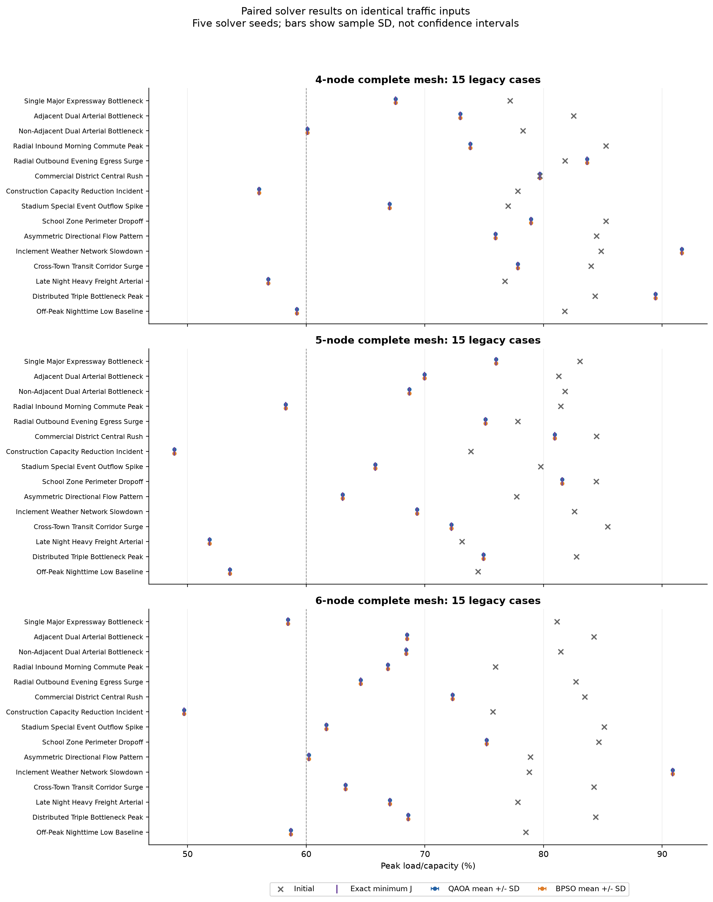
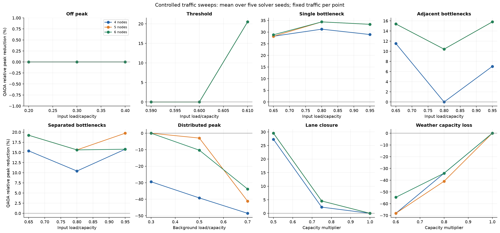
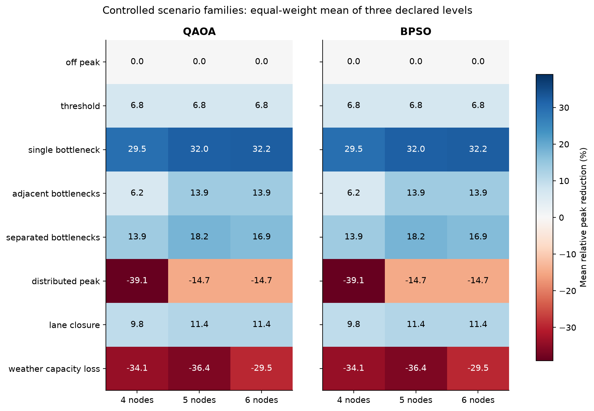
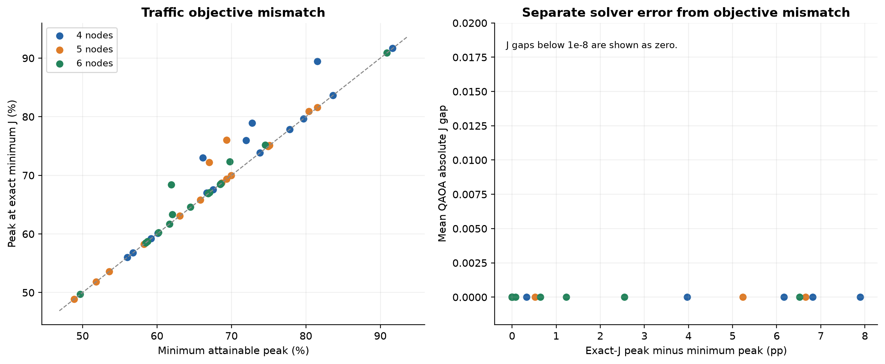
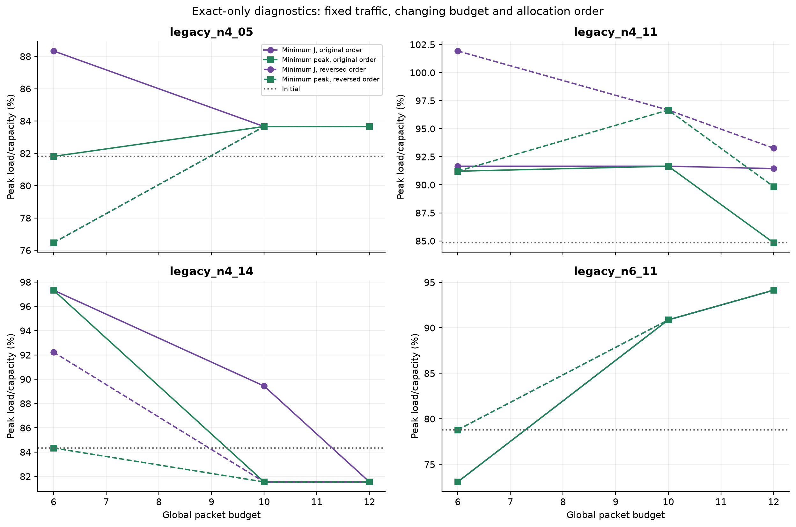

# Traffic scenario evaluation

Prepared for Yash's assigned evaluation task. This package contains new, executed optimizer-only experiments on synthetic traffic states. It evaluates the repository's existing mandatory two-detour encoding. It does not measure STQGCN inference, real traffic, IBM hardware, travel times, or queue recovery.

## Main findings

Across the 45 legacy traffic inputs, the QAOA mean peak improved the unmanaged state in 40 cases, was unchanged in 1, and worsened in 4. Comparing five-seed mean peaks, QAOA was lower than BPSO in 0 cases, tied in 45, and was higher in 0.

Median relative peak reductions computed across scenario-level QAOA means were 4 nodes: 11.57%, 5 nodes: 16.05%, 6 nodes: 18.71%. These are new results under the settings recorded below; they replace no previous artifact automatically.

There are 13/45 legacy cases in which the lowest peak among exact J optima is higher than the minimum attainable candidate peak. In 3/45 cases, even the minimum-peak candidate worsens the unmanaged state. These two diagnostics distinguish objective mismatch and limitations of the represented route choices from solver approximation.

## Experiment design

- 45 unchanged legacy cases: 15 per complete graph of 4, 5, and 6 nodes, traffic seed 2026.
- 72 controlled cases: eight scenario families, three declared levels, three graph sizes. Within a sweep only the named demand or capacity parameter changes.
- Two sparse-graph diagnostics: one detour and no detour. The current packet generator requires two detours and therefore does not invoke either solver for these cases.
- Five solver seeds per case: [42, 123, 456, 789, 2026]. Traffic remains fixed across these repetitions. Variation represents solver initialization/measurement randomness, not generalization to new traffic realizations.
- QAOA: Qiskit StatevectorSampler, depth 1, 1024 shots per sampler evaluation, seeded initial beta/gamma, COBYLA maxiter 50 and tolerance 1e-4. Circuits are compiled to h/rx/rz/cx at optimization level 0. A state-probability equivalence check verifies the compilation.
- BPSO: the repository's Particle update rules, 30 particles, 20 iterations, w=0.5 and c1=c2=1.5. There are 30 initial plus 600 iterative fitness evaluations, hence 630 per solve. The adapter operates directly on the shared saved QUBO and was checked against the production engine.
- Every candidate bitstring is enumerated to obtain separate minimum-J and minimum-peak references. Every enumerated QUBO value is checked against a direct calculation from decoded edge loads.

The run contains 1547 result records and 480 actual QAOA solves. 115 QAOA records are explicit no-action cases with no solver invocation. Solver failures: 0. Exact reference methods and unmanaged inputs are stored once per case; repeated no-action rows preserve the five-seed pairing but are not counted as quantum solves.

QAOA reached the exact minimum J within an absolute tolerance of 1e-8 in 478/480 actual solves. This is solution-quality evidence on compact simulated instances; it does not establish quantum computational advantage. Agreement in J does not imply minimum peak congestion.

No claim of statistical significance or algorithmic equivalence is made from these descriptive repetitions. Means and sample SD are reported. Sanjay can extend the saved inputs with his independent reproducibility/statistical protocol. Runtime is a recorded solver-wrapper wall-clock measurement and is not used to claim quantum speedup or end-to-end performance.

## Legacy results

| Nodes | Method | Cases | Improved | Unchanged | Worsened | Median relative reduction (%) |
| --- | --- | --- | --- | --- | --- | --- |
| 4 | QAOA | 15 | 11 | 1 | 3 | 11.57 |
| 4 | BPSO | 15 | 11 | 1 | 3 | 11.57 |
| 5 | QAOA | 15 | 15 | 0 | 0 | 16.05 |
| 5 | BPSO | 15 | 15 | 0 | 0 | 16.05 |
| 6 | QAOA | 15 | 14 | 0 | 1 | 18.71 |
| 6 | BPSO | 15 | 14 | 0 | 1 | 18.71 |

Counts use each case's mean final peak over five solver seeds and a tolerance of 1e-8 percentage points. Per-trial outcomes remain in the raw records. Median reduction is the median of case-level relative reductions; it is not a ratio of averaged peaks. `tables/legacy_45_results.csv` provides dedicated QAOA and BPSO columns plus both exact references.

## Controlled scenarios

| Nodes | Method | Cases | Improved | Unchanged | Worsened | Median relative reduction (%) |
| --- | --- | --- | --- | --- | --- | --- |
| 4 | QAOA | 24 | 11 | 8 | 5 | 0.00 |
| 4 | BPSO | 24 | 11 | 8 | 5 | 0.00 |
| 5 | QAOA | 24 | 12 | 8 | 4 | 2.27 |
| 5 | BPSO | 24 | 12 | 8 | 4 | 2.27 |
| 6 | QAOA | 24 | 12 | 8 | 4 | 2.27 |
| 6 | BPSO | 24 | 12 | 8 | 4 | 2.27 |

Off-peak ratios are 0.20/0.30/0.40. Trigger-boundary ratios are 0.59/0.60/0.61. Single/adjacent/separated bottleneck ratios are 0.65/0.80/0.95 with background 0.30. Distributed-peak cases hold three bottlenecks at 0.85 and vary background at 0.30/0.50/0.70. Lane closure multiplies one capacity by 1/0.75/0.50. Weather multiplies all capacities by 1/0.80/0.60. Both capacity sweeps hold loads fixed at 0.55 of original capacity; reduced-capacity ratios may exceed 1 and are retained, not clipped. Levels are declared synthetic settings, not empirical calibration.

All nine controlled single-bottleneck cases improved peak occupancy, with relative reductions of 28.21% to 34.38%. All nine separated-bottleneck cases also improved (10.42% to 19.74%). In contrast, distributed-peak cases worsened in 7/9 cases and were unchanged in 2/9; no case improved. All six reduced-capacity weather cases worsened; the three unreduced-capacity controls required no action. These outcomes were shared by BPSO. They support a conditional interpretation: this rerouting model helps localized demand when useful detours exist, but can amplify congestion under widespread load/capacity stress. The attribution is limited to these declared synthetic inputs.

## Why weak or negative outcomes occur

The bit selects detour 1 or detour 2; every allocated packet leaves its origin. All-zero bits do not represent the unmanaged state. Therefore the route-choice search space may exclude the original traffic state. A separate reject-if-peak-worsens policy is recorded as `guarded_final_peak_pct`; guarded outcomes are not substituted for raw outcomes in any main table.

The weighted squared-distance objective J is not the maximum load/capacity ratio. A minimum-J assignment can have a worse peak than another represented assignment. A QUBO optimality gap must use the minimum-J reference. The minimum-peak reference is a distinct traffic diagnostic. Tied minimum-J solutions can have different peaks; the full range of ground-state peaks is retained in exact references.

The current code has no implemented hard capacity penalty despite an unused `capacity_penalty_weight` argument. Overloads are measured and retained. Packet allocation uses congestion-edge iteration order and stops at the global budget, which can omit later origins. Having 10 allocated packets alone does not prove truncation; requested and omitted packet counts are recorded.

## Packet-budget and allocation-order diagnosis

Four fixed legacy cases were enumerated at budgets 6, 10, and 12 under original and reversed capacity-edge insertion order, giving 24 exact-only variants. QAOA was not rerun for these variants; this isolates changes in the decision space.

| Case | Initial (%) | Exact-J peak, cap 10 | Exact-J peak, cap 12 | Exact-J peak, reversed cap 10 |
| --- | --- | --- | --- | --- |
| legacy_n4_05 | 81.81 | 83.66 | 83.66 | 83.66 |
| legacy_n4_11 | 84.84 | 91.66 | 91.45 | 96.66 |
| legacy_n4_14 | 84.34 | 89.44 | 81.54 | 81.54 |
| legacy_n6_11 | 78.79 | 90.87 | 94.13 | 90.87 |

These are changes to the represented packet/route set, not a quantum-circuit scaling study. A larger budget need not improve the peak: the present encoding forces additional packets to detour, and the objective minimizes J. Consult the minimum-peak columns in `results/budget_order_diagnostics.csv` before assigning a cause.

The 4-node evening-surge case requests and allocates exactly 10 packets, so no packet is omitted at the 10-packet budget. Raising the budget to 12 leaves the represented problem and its 83.66% minimum peak unchanged, above the 81.81% initial peak. This directly rules out budget truncation as the explanation for that negative case under the current route rules. For the 4-node multiple-bottleneck case, minimum peak is 81.54% while the minimum-J peak is 89.44%, providing a different diagnosis: objective mismatch.

## Practical interpretation

| Case | Initial (%) | QAOA mean (%) | Relative relief (%) | Absolute relief (pp) |
| --- | --- | --- | --- | --- |
| legacy_n5_09 | 84.45 | 81.57 | 3.42 | 2.89 |
| legacy_n5_05 | 77.83 | 75.11 | 3.50 | 2.72 |
| legacy_n5_06 | 84.47 | 80.94 | 4.17 | 3.53 |

A positive peak reduction can leave the busiest edge above the 60% trigger and can increase congestion on secondary edges. Peak relief is therefore reported alongside edge-level ratios, congested-edge counts, and overloads. Static snapshots cannot establish travel-time, queue-length, throughput, or real-world operational benefits. Detailed strong, marginal, and negative examples are in [CASE_STUDIES.md](CASE_STUDIES.md).

## Reconciliation with previous artifacts

The supplied 20-page paper reports 40 improved, one unchanged, and four worsened initial states, and identical single-seed QAOA/BPSO peaks in all 45 cases. The repository's pre-existing CSV instead contains 36 improved, 0 unchanged, and 9 worsened states; QAOA is lower/tied/higher than BPSO in 5/15/25 rows. The audit is calculated from saved rounded values. The old file remains unchanged.

The new experiment uses explicit seeded Qiskit execution and shared saved problems. It should be treated as a newly documented experiment version. The previous manuscript's 13/32 significance counts, 32 exact matches, and latency figures must not be carried into this result set without their original raw evidence and a matching analysis.

## Reproducibility and limitations

`results/run_metadata.json` records commit f06176e7a3fd746fd98abec895becfbc36ad937b, source hashes, Python/platform, dependencies, seeds, and full settings. `results/scenario_manifest.json` stores all traffic inputs. `results/cases/` stores complete QUBOs, packet choices, exact references, solver traces and edge results. The repository source uses undirected merging; directional commuting effects are not evaluated. The underlying formulation is intentionally preserved and its discrepancies with the papers are documented. The submitted manuscript must describe that formulation accurately or the team must implement and rerun its intended stay-versus-detour model.

This package completes the traffic-scenario evaluation. Separate team work remains IBM hardware/end-to-end inference (Aditya), broader independent reproducibility/statistical inference (Sanjay), and quantum resource scaling (Vedant).
